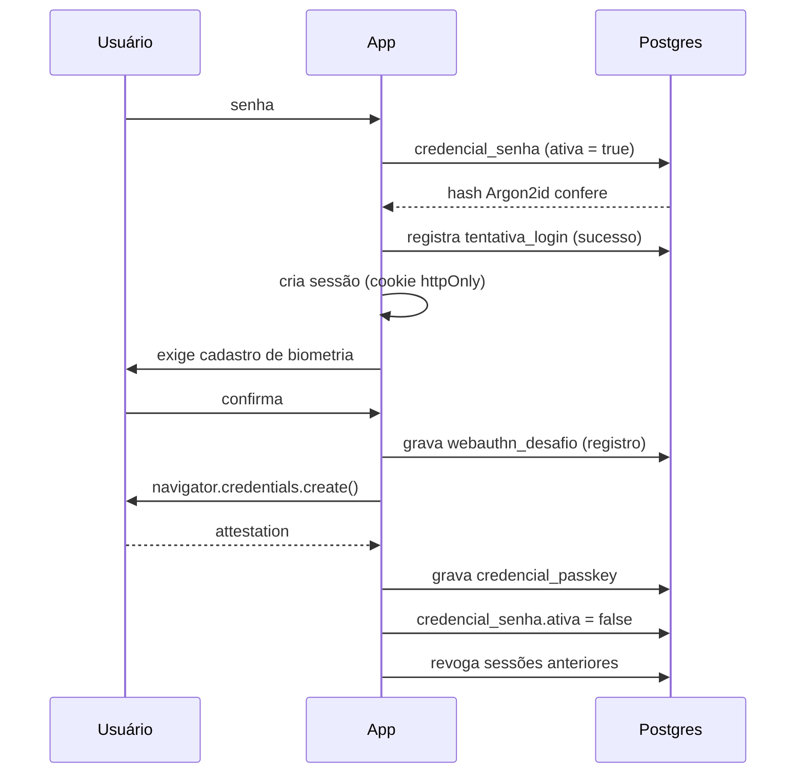

# Mapa de autenticação

Regra de origem: o app não tem gestão de usuários. Tem um portão. Primeiro acesso com senha, cadastro de biometria, senha desativada, e um reset disponível tanto na interface quanto por linha de comando direto no banco.

## Pré-requisito que não é opcional

WebAuthn (a API que dá acesso à biometria do dispositivo) só funciona em **contexto seguro com domínio estável**:

- não funciona em `http://192.168.x.x` — nem com certificado autoassinado não confiado;
- o **RP ID** da passkey é o domínio. Se o domínio mudar, toda passkey cadastrada é invalidada e o único caminho de volta é a CLI de reset.

Por isso a infraestrutura decidida é **Cloudflare Tunnel** com domínio próprio: a mesma URL em casa e na rua, TLS válido, nenhuma porta aberta no roteador, e `rp_id` imutável. O domínio escolhido é parte do contrato de autenticação, não um detalhe de deploy — ele fica gravado em `config_app.rp_id` para o app detectar divergência e explicar o que aconteceu em vez de falhar em silêncio.

## Usuário

Existe um só, e ele não é gerenciável pela interface. Nome e senha inicial vêm do `.env` e são gravados no banco pelo seed do Knex:

```
APP_USUARIO_NOME=Tiago      # só para a saudação do dashboard
APP_SENHA_INICIAL=...       # semeia credencial_senha (hash Argon2id); use uma vez e troque no .env
```

O nome tem função puramente de apresentação — "Boa tarde, Tiago" no dashboard. **A tela de login não pede usuário**, só senha: com um único usuário, o campo seria decorativo e só daria mais uma coisa a digitar antes da biometria assumir.

## Fluxos

### Primeiro acesso



Não existe estado intermediário utilizável: enquanto a passkey não é cadastrada, a sessão só dá acesso à tela de cadastro de biometria.

### Acesso recorrente

Desafio gerado no servidor, `navigator.credentials.get()` no cliente, verificação da assinatura e do contador anti-clonagem, atualização de `counter` e `ultimo_uso_em`, nova sessão. Senha inativa não é aceita em nenhuma hipótese — o endpoint de login por senha responde negativamente quando existe passkey ativa, para que desativada signifique desativada.

### Reset pela interface

Disponível em Ajustes, **com sessão válida**. Apaga as passkeys, reativa `credencial_senha`, revoga todas as sessões e devolve ao login. Serve para trocar de dispositivo de forma planejada: resetar no aparelho antigo, entrar com senha no novo, cadastrar a biometria dele.

### Reset pela CLI

O caminho para quando não há sessão: celular perdido, quebrado ou formatado. Roda **no homelab**, com acesso direto ao Postgres, sem passar pelo app.

```
npm run cli:reset-biometria
```

O que faz, em uma transação: apaga `credencial_passkey`, define uma senha provisória em `credencial_senha` com `ativa = true`, revoga todas as sessões, limpa bloqueios de `tentativa_login`, e imprime a senha provisória no terminal uma única vez. O próximo acesso pela web cai de novo no fluxo de primeiro acesso.

Requisitos de projeto da CLI:

- conecta pela rede interna do Docker com a mesma configuração do Knex, lendo `DATABASE_URL`; não abre o Postgres para fora;
- exige confirmação interativa, por ser destrutiva e irreversível;
- gera a senha provisória aleatória em vez de aceitar uma por argumento, para não vazar em histórico de shell;
- registra a execução em log com data e hora.

Vale ter também um `npm run cli:reset-senha`, para o caso de a senha provisória ser perdida antes do uso.

**Acesso remoto ao homelab não está previsto** — rodar a CLI exige estar na rede local. Consequência aceita: perder o celular fora de casa significa ficar sem o app até voltar. Dentro da janela retroativa de 7 dias, o histórico pode ser recuperado depois; passando disso, os dias perdidos ficam como falha.

## Rate limiting — onda 1

A janela em que a senha está ativa é curta, mas é a única em que força bruta faz sentido, e o app fica exposto na internet pelo túnel. Entra na primeira entrega.

- **Atraso progressivo** por tentativa falha do mesmo IP: 0s, 1s, 2s, 4s, 8s.
- **Bloqueio temporário** de 15 minutos após 5 falhas em 15 minutos, por IP.
- Contagem em `tentativa_login` (tabela, não memória) para sobreviver ao restart do contêiner.
- A resposta de bloqueio não revela se a senha estava correta.
- O worker limpa tentativas com mais de 7 dias.

> **O IP tem de vir de `CF-Connecting-IP`.** Atrás do Cloudflare Tunnel, o IP do socket é sempre o do próprio túnel: usá-lo transformaria o bloqueio por IP em um bloqueio global do app — você se trancaria para fora com cinco erros de digitação.

O endpoint de autenticação WebAuthn não precisa do mesmo limite (não há segredo a adivinhar), mas a emissão de desafios vale limitar para não servir de torneira de escrita em `webauthn_desafio`.

## Sessão

Cookie `httpOnly`, `Secure`, `SameSite=Lax`, contendo um token opaco cujo **hash** é o que vive no banco. Validade longa (30 dias) com renovação por uso — é uso pessoal, e reautenticar por biometria é barato, mas não há motivo para expirar à toa. Revogação em massa acontece em todo reset e em todo cadastro de nova passkey.

## Limites aceitos conscientemente

| Limite | Consequência | Mitigação |
|---|---|---|
| Uma passkey, um dispositivo | trocar de aparelho exige reset | reset planejado em Ajustes, antes de trocar |
| Perda do dispositivo | sem acesso até rodar a CLI **na rede local** | janela retroativa de 7 dias recupera o histórico |
| Domínio mudou | passkey invalidada | `rp_id` gravado + CLI de reset |

O consumo automático de congelamento removeu o pior item desta lista: antes, com resgate manual em 24h, ficar longe do único aparelho autenticado custava a sequência. Agora a sequência se protege sozinha enquanto houver estoque.

Se o incômodo de "um dispositivo só" aparecer na prática, a saída menos invasiva é o **código de pareamento**: gerar um código temporário de um dispositivo autenticado para cadastrar a biometria de outro, mantendo a senha permanentemente inativa.

## Pendências

1. **Rotação da senha inicial** — o `.env` guarda `APP_SENHA_INICIAL` para o seed, e depois ela fica inútil (a senha é desativada no cadastro da biometria). Decidir se o seed limpa a variável do ambiente efetivo ou se basta documentar que ela é descartável.
2. **Expiração de `webauthn_desafio`** — limpeza pelo worker junto com `tentativa_login`, ou só filtro por `expira_em` na consulta? O segundo é suficiente até a tabela incomodar.
