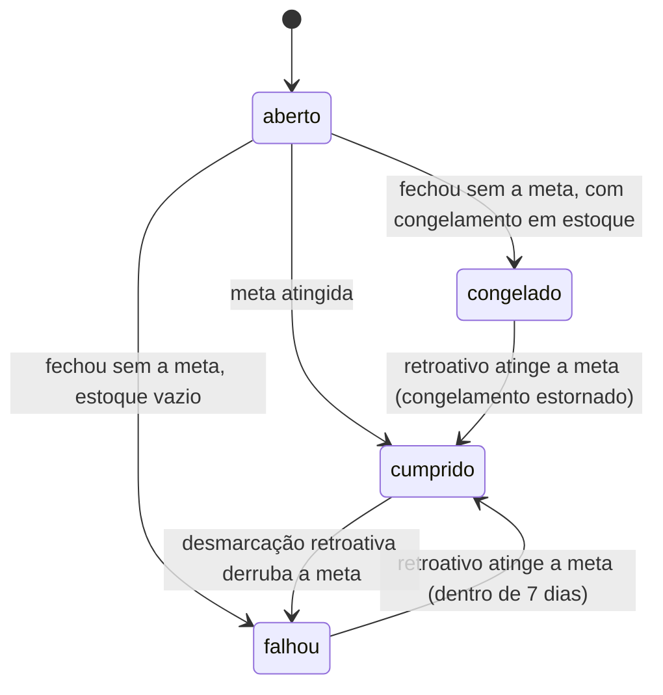

# Mapa de regras

Semântica do domínio: o que é um período, quando ele é cumprido, como a sequência conta e como o congelamento funciona. Este arquivo é a fonte da verdade sobre comportamento; o banco e as telas apenas o refletem.

## Decisões fundamentais

| Tema | Decisão |
|---|---|
| Multiusuário | Não existe. App single-tenant, uma credencial única, sem cadastro nem `user_id` nas tabelas |
| Virada do dia | **04:00** no fuso `America/Sao_Paulo`. Um registro às 01:30 pertence ao dia anterior |
| Início da semana | **Domingo** (dia 1 = domingo … dia 7 = sábado) |
| Tipos de hábito | binário, quantificado, negativo e duração/cronômetro |
| Configuração | **Versionada**: cada período guarda qual regra valia na época |
| Congelamento | **Automático**, consumido no fechamento do período, antes de declarar falha |
| Retroativo | Janela de **7 dias lógicos**, permitindo marcar e desmarcar |
| Sequência | Conta **interações concluídas no prazo**, individual por hábito |
| Uso offline | **Não suportado.** O app exige conexão para registrar |
| Ciclo de vida | Hábito se **arquiva** (nunca se exclui) e pode ser **pausado** |

### Dia lógico

```
data_logica(ts) = ((ts AT TIME ZONE 'America/Sao_Paulo') - interval '4 hours')::date
```

Toda fronteira de período (início, fim, vencimento) é derivada dessa função, nunca de `CURRENT_DATE` puro.

Atenção: a saudação do dashboard ("bom dia/boa tarde/boa noite") usa a **hora de parede**, não o dia lógico — à 01:00 a saudação é "boa noite" mesmo que o dia lógico ainda seja o anterior.

## Tipos de hábito

O tipo define o que significa "cumprir" e qual campo de meta é usado.

| Tipo | Meta | Cumprido quando | Exemplo |
|---|---|---|---|
| `binario` | — | existe 1 registro | Fazer a cama |
| `quantificado` | `meta_valor` + `unidade` | soma dos registros ≥ meta | Beber 2 L de água |
| `duracao` | `meta_minutos` | soma dos minutos ≥ meta | Meditar 10 min |
| `negativo` | `tolerancia_recaidas` (padrão 0) | nº de registros ≤ tolerância | Não fumar |

O hábito `negativo` inverte a lógica: a ocorrência nasce **cumprida** e o registro representa uma recaída, não um sucesso. Consequência: ele só pode falhar por ação explícita sua, nunca por omissão — e, por isso, nunca consome congelamento.

## Cadência e modo

A configuração tem **uma** cadência e **um** modo, mutuamente exclusivo. Isso substitui os campos originais "período externo" e "período interno", que se sobrepunham e permitiam combinações sem sentido.

**Cadência** — define a janela que é o período:

- `diario` — um período por dia lógico
- `cada_n_dias` — janela de N dias **ancorada na última conclusão** (ver abaixo)
- `semanal` — um período por semana, domingo a sábado
- `mensal` — um período por mês civil

**Modo** — define como o período é cumprido:

- `flexivel` — meta de `meta_ocorrencias` conclusões em qualquer momento do período. Ex.: academia 3x por semana, tanto faz o dia.
- `fixo` — conclusões em momentos determinados, declarados em `dias_semana`, `dias_mes` e/ou `horarios`. Cada momento é uma **ocorrência** própria, marcável e notificável de forma independente. Ex.: remédio todo dia às 08:00 e 20:00 (duas ocorrências por período).

Combinações válidas:

| Cadência | `flexivel` | `fixo` |
|---|---|---|
| `diario` | meta N vezes no dia | `horarios[]` |
| `cada_n_dias` | meta N vezes na janela | **não permitido** |
| `semanal` | meta N vezes na semana | `dias_semana[]` (+ `horarios[]` opcional) |
| `mensal` | meta N vezes no mês | `dias_mes[]` (+ `horarios[]` opcional) |

> `cada_n_dias` aceita só o modo `flexivel`: com a janela ancorada na última conclusão, ela anda no calendário, e horários fixos dentro de uma janela móvel não descrevem nada. O lembrete desse hábito usa `notificar_em` e cai no **dia do vencimento**.

### Ancoragem de `cada_n_dias`

A janela é relativa à última conclusão, não a um calendário fixo:

- **Primeiro período**: `[habito.inicio_em, inicio_em + N - 1]`.
- **Conclusão fecha o período na hora.** Ao atingir a meta na data `D`, o período é encerrado com `fim = D` e o seguinte abre em `[D + 1, D + N]`. Lavei o carro no 3º dia de uma janela de 15 → o próximo vencimento é 15 dias depois da lavagem, não do início da janela.
- **Período perdido** não tem conclusão para ancorar: o seguinte abre no dia após o fim, `[fim + 1, fim + N]`.
- Quando a meta é maior que 1, a âncora é a data da conclusão **que fechou a meta**.

Duas consequências que o código precisa respeitar:

1. `habito_periodo.fim` é **mutável** nessa cadência — conclusão antecipada encurta o período. Nas outras cadências o `fim` é imutável.
2. Períodos **não são pré-gerados em nenhuma cadência**: existe no máximo um período aberto por hábito, criado quando o anterior fecha. `cada_n_dias` obriga a isso, porque o próximo início depende da conclusão do atual; uniformizar as outras cadências pelo mesmo caminho evita que um período futuro nasça preso a uma versão de configuração que você ainda vai editar. O banco garante o invariante com índice único parcial.

## Período e ocorrência

- **Período** é a janela de avaliação. É materializado no banco quando começa, não calculado em tempo de leitura — porque a auditoria da sequência e o consumo de congelamento exigem um registro estável.
- **Ocorrência** é a unidade marcável. No modo `fixo` existe uma por momento previsto. No modo `flexivel` não há momentos previstos: os registros se ligam direto ao período e a meta é contada por soma.

### Estados do período



O fechamento é uma decisão única e imediata, sem estado de espera: havendo congelamento disponível, ele é consumido; não havendo, o período falha e a sequência zera. A correção posterior é o preenchimento retroativo, limitado a 7 dias.

## Sequência (streak)

Cada hábito tem a **sua** sequência, exibida na própria linha do dashboard. Não existe sequência global do app — o número grande no topo da tela foi substituído por indicadores individuais.

A contagem é de **interações concluídas no prazo**, não de dias corridos:

- No modo `fixo`, cada ocorrência cumprida soma 1.
- No modo `flexivel`, cada período cumprido soma 1.
- "No prazo" significa **dentro do período correto**, independentemente de quando o registro foi criado. Um preenchimento retroativo dentro da janela de 7 dias conta normalmente — senão a tela de retroativo não teria função.
- Período `congelado` **preserva** a sequência, mas não soma nem conta para ganhar novo congelamento.
- Período `falhou` zera a sequência atual. O recorde histórico é preservado.

Guardamos `sequencia_atual`, `sequencia_recorde` e `total_no_prazo` por hábito, materializados e sempre recalculáveis a partir dos períodos — qualquer edição retroativa dispara recálculo da data afetada para frente.

## Congelamento

Mecânica de proteção de sequência, configurável por hábito.

**Ganho** — a cada `congelamento_a_cada` interações consecutivas concluídas no prazo, ganha-se 1 congelamento, limitado a `congelamento_max`. Com o estoque cheio, ganhos novos são descartados (não acumulam fila). O contador acompanha a sequência atual, então 3/6/9 geram um congelamento cada.

**Consumo** — **automático**, no fechamento do período. Se a meta não foi atingida e há congelamento disponível, o mais antigo do estoque é consumido (FIFO), o período fica `congelado` e a sequência segue intacta. Estoque vazio significa `falhou` na mesma transação.

Períodos congelados não contam como consecutivos para o ganho — caso contrário, nunca fazer o hábito geraria congelamentos.

**Estorno** — se um preenchimento retroativo faz um período `congelado` atingir a meta, o congelamento volta ao estoque e o período passa a `cumprido`. Congelamento consumido em período que depois é desmarcado permanece consumido.

> Efeito colateral aceito: o congelamento é gasto sem pedir licença, inclusive em dia que você decidiu folgar de propósito. Em troca, a sequência nunca cai por desatenção — o que era o risco real do modelo manual, dado o acesso por um único dispositivo.

**Não existe desfazer** de um consumo automático. O retroativo já cobre o caso que importa (fiz, só não registrei), e um desfazer cuja única função é zerar a própria sequência de propósito não tem uso prático.

## Pausa e arquivamento

- **Pausar** suspende o hábito sem punição: nenhum período é gerado no intervalo, nada falha e a sequência é preservada para continuar na volta. Em `cada_n_dias`, a pausa também congela o relógio — a âncora é deslocada pela duração da pausa, de modo que voltar de 20 dias de férias não cria um vencimento já estourado. A pausa pode ser **agendada** (`pausado_ate` preenchido, retoma sozinha) ou **aberta** (`pausado_ate` nulo, retoma quando você mandar).
- **Arquivar** é o fim da vida útil do hábito, sempre reversível e sempre preservando o histórico. Não existe exclusão permanente pela interface.

## Preenchimento retroativo

- Janela: **7 dias lógicos** para trás, contados do dia lógico atual.
- Permite marcar e desmarcar. Datas anteriores ao `inicio_em` do hábito e dentro de uma pausa não são preenchíveis.
- Todo registro guarda `origem` (`app`, `retroativo`, `cronometro`) — a janela é curta justamente para o histórico manter credibilidade, e a origem deixa isso auditável.
- Qualquer alteração dispara recálculo de sequência e revisão de congelamentos a partir da data afetada.
- **Em `cada_n_dias`, o retroativo re-encadeia a cronologia.** Como a âncora é a última conclusão, marcar ou desmarcar uma data move o início de todos os períodos seguintes. O recálculo precisa regenerar a cadeia de períodos a partir do ponto alterado, não apenas reavaliar os existentes. É a parte mais delicada desta decisão e merece teste automatizado próprio.

## Notificações

Todas via Web Push, disparadas pelo worker que roda a cada minuto e registra o que já enviou para não duplicar.

| Evento | Quando | Observação |
|---|---|---|
| `lembrete` | no `horarios[]` (modo `fixo`) ou `notificar_em` (modo `flexivel`) | só se a ocorrência/meta estiver pendente |
| `meta_atraso` | último dia lógico de período `flexivel` com meta não batida | cadência `semanal` e `mensal`; único aviso **antes** da perda |
| `congelamento_usado` | ao fechar período como `congelado` | informa quantos restam no estoque |
| `sequencia_perdida` | ao fechar período como `falhou` | sequência zerada, com o número que foi perdido |

> Os dois últimos substituem a notificação de "sequência em risco" planejada antes: com consumo automático não existe mais janela de decisão, então o aviso deixa de ser um pedido de ação e passa a ser comunicação do que já aconteceu. Em `cada_n_dias`, `meta_atraso` não se aplica — o dia do vencimento já é o próprio `lembrete`.

O worker é o mesmo processo que fecha períodos e abre os seguintes — fechamento de período é o gatilho de tudo.

## Pendências a decidir

Nenhuma em aberto neste mapa. O sequenciamento da implementação está no [Roadmap da onda 1](../Roadmap%20onda%201.md).
