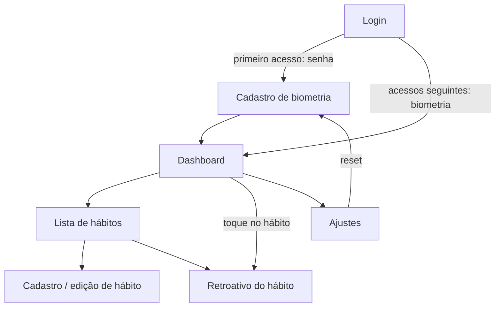

# Mapa de telas

App pessoal, mobile-first, instalável como PWA (requisito para notificação no iOS). UI em pt-BR, sem suporte offline — toda ação exige conexão. Comportamento de cada regra citada aqui está em [Mapa de regras](Mapa%20de%20regras.md).

## Ondas

| Onda | Escopo |
|---|---|
| **1** | Login, cadastro de biometria, dashboard, lista de hábitos, cadastro/edição, retroativo de 7 dias, ajustes, notificações e rate limiting |
| **2** | Tela de detalhe/histórico do hábito (heatmap, evolução do quantificado, gráfico de minutos, congelamentos ganhos e gastos) |

A onda 2 está mapeada na seção [Detalhe do hábito](#8-detalhe-do-hábito--onda-2) para o schema já nascer compatível, mas não entra na primeira entrega.

## Navegação



Barra inferior com três destinos: **Hoje** (dashboard), **Hábitos** (lista) e **Ajustes**. Retroativo e cadastro abrem como tela cheia sobre a navegação, não como aba.

---

## 1. Login

Única tela pública. Só pede **senha** — não há campo de usuário, porque existe um único usuário e o nome serve apenas para a saudação do dashboard.

| Estado | O que aparece |
|---|---|
| Nenhuma passkey cadastrada | campo de senha |
| Passkey cadastrada | botão único "Entrar com biometria", sem campo de senha |
| Passkey cadastrada + navegador sem WebAuthn | aviso de dispositivo não suportado e instrução de rodar a CLI de reset |
| Bloqueado por tentativas | tempo restante do bloqueio, sem revelar se a senha estava correta |

Após o login com senha no primeiro acesso, vai direto para o cadastro de biometria — não existe caminho que deixe o app em uso com senha ativa.

Erros a tratar explicitamente: senha errada (com atraso progressivo), biometria cancelada pelo usuário, passkey desconhecida pelo servidor, e domínio divergente do `rp_id` gravado (mensagem específica, porque nesse caso a biometria está irrecuperável sem CLI).

## 2. Cadastro de biometria

Aparece no primeiro acesso e após um reset. Explica em uma frase o que vai acontecer — a senha será desativada e aquele dispositivo passa a ser o único com acesso — e exige confirmação consciente antes de disparar o WebAuthn.

Ao concluir: desativa a senha, revoga sessões antigas, oferece a instalação da PWA e pede permissão de notificação. Esses dois pedidos ficam aqui porque é o único momento em que o usuário está atento ao setup.

## 3. Dashboard — "Hoje"

Tela inicial. Foco no que é devido hoje, com **a sequência de cada hábito na própria linha** — não há número global de sequência, que não dizia nada de útil.

```
┌────────────────────────────────────┐
│ Boa tarde, Tiago                   │
│ Terça, 9 de novembro               │
├────────────────────────────────────┤
│ HOJE                               │
│ ○ 💧 Água         0/2 L    🔥 8 ❄2 │
│ ○ 🏋 Academia   2/3 sem.  🔥 12 ❄1 │
│ ✓ 💊 Remédio      08:00   🔥 30 ❄3 │
│ ○ 💊 Remédio      20:00   🔥 30 ❄3 │
│ ○ 🧘 Meditar     0/10 min  🔥 5 ❄0 │
│ ✓ 🚭 Não fumar  sem recaída 🔥 44  │
├────────────────────────────────────┤
│ AVISOS                             │
│ ❄ Leitura: congelamento usado      │
│   ontem · resta 1                  │
├────────────────────────────────────┤
│ [ Hoje ]   [ Hábitos ]  [ Ajustes ]│
└────────────────────────────────────┘
```

**Saudação** — "Bom dia / Boa tarde / Boa noite" + `config_app.usuario_nome`, pela hora de parede (não pelo dia lógico): à 01:00 é "boa noite", ainda que o dia lógico seja o anterior.

**Sequência por hábito** — cada linha mostra `🔥 sequencia_atual` e `❄ congelamentos disponíveis`. O 🔥 é o indicador de interações consecutivas concluídas no prazo daquele hábito; em modo `fixo` conta ocorrências, em `flexivel` conta períodos. O recorde e o total histórico ficam na tela de detalhe (onda 2), não aqui.

**Lista de hoje** — uma linha por interação devida, não por hábito: um hábito `fixo` com dois horários rende duas linhas, cada uma marcável, ambas exibindo a mesma sequência do hábito. A ordem segue `habito.ordem`. Cada linha mostra o progresso na forma própria do tipo (contagem, volume, minutos, ou "sem recaída" no negativo). Toque curto marca; toque na linha abre o retroativo daquele hábito.

Ações por tipo: `binario` marca direto; `quantificado` abre incremento rápido com o passo da unidade; `duracao` oferece cronômetro ou entrada manual de minutos; `negativo` registra recaída (ação destrutiva, com confirmação).

**Bloco de avisos** — informativo e dispensável, aparece quando um período fechou recentemente como `congelado` ou `falhou`. Substitui o antigo bloco "em risco", que deixou de existir com o consumo automático de congelamento: não há mais nada a decidir no prazo, só a comunicar.

**Estado vazio** — nenhum hábito cadastrado leva ao cadastro; todos cumpridos mostra a confirmação do dia fechado em vez de uma lista vazia ambígua.

### Cronômetro (tipo `duracao`)

Precisa sobreviver ao app **minimizado**, mas não ao app **fechado**. Isso define a implementação:

- guardar `iniciado_em` (timestamp absoluto) em `sessionStorage`, que morre junto com a PWA fechada — exatamente o comportamento desejado, e nada de linha no banco para timer em andamento;
- o tempo exibido é sempre `agora - iniciado_em`, recalculado em `visibilitychange`. **Nunca acumular por ticks de `setInterval`**: o navegador estrangula timers em segundo plano e a contagem chegaria errada ao voltar;
- ao parar, grava um `registro` com os minutos decorridos e `origem = 'cronometro'`;
- app fechado com cronômetro rodando descarta a sessão em andamento — comportamento explícito na interface antes de iniciar, para não parecer perda de dados.

## 4. Lista de hábitos

Todos os hábitos ativos com nome (emoji incluso), cor, resumo da cadência em linguagem natural ("3x por semana", "todo dia às 08:00 e 20:00", "a cada 15 dias"), sequência e congelamentos em estoque. Arquivados ficam em seção recolhida ao final.

**Ordenação** — padrão por data de criação, com **reordenação manual por arraste**, persistida em `habito.ordem`. A ordem escolhida aqui é a mesma usada no dashboard.

Ações: criar, editar, pausar/retomar, arquivar/desarquivar e abrir o retroativo. Não existe exclusão permanente.

## 5. Cadastro / edição de hábito

Formulário em etapas, porque a configuração é grande o bastante para não caber de uma vez.

1. **Identidade** — nome e cor (paleta fechada). **Não há campo de ícone**: o emoji de sinalização é digitado dentro do próprio nome (`💧 Água`), aproveitando o teclado de emoji do sistema em vez de um seletor próprio.
2. **Tipo** — binário, quantificado (valor + unidade), duração (minutos) ou negativo (tolerância de recaídas). Define quais campos de meta aparecem adiante.
3. **Cadência** — diário, a cada N dias, semanal ou mensal. Em "a cada N dias", explicar na tela que a contagem reinicia **na última conclusão**: concluir no 3º dia de uma janela de 15 joga o próximo vencimento para 15 dias depois daquela conclusão.
4. **Modo** — escolha excludente entre *flexível* ("N vezes no período") e *fixo* ("nestes dias e horários"). A tela precisa deixar claro que são caminhos alternativos; é o ponto em que o modelo antigo de "período externo + interno" gerava combinação inválida. Em cadência "a cada N dias" o modo fixo não é oferecido.
5. **Notificação** — horário do lembrete. No modo `fixo`, derivado dos horários já informados.
6. **Congelamento** — ativar, a cada quantas interações ganha um, e o estoque máximo. Mostrar em texto o efeito **e o automatismo**: "a cada 3 interações no prazo você ganha 1 congelamento, até 2 guardados; se você perder um período, um congelamento é usado automaticamente para manter a sequência".

O resumo final descreve a regra em uma frase antes de salvar.

**Ao editar**, avisar que a mudança vale a partir de hoje e que o histórico continua avaliado pela regra antiga — é o comportamento de versionamento, e sem aviso parece bug.

## 6. Preenchimento retroativo

Por hábito, janela de **7 dias lógicos**. Semana começando no domingo.

```
┌──────────────────────────────────┐
│ ← 🏋 Academia                    │
│ 2 de 3 nesta semana · 🔥 12 ❄1   │
├──────────────────────────────────┤
│ ter 09/11  hoje      ○           │
│ seg 08/11            ✓           │
│ dom 07/11            —           │
│ sáb 06/11            ✓           │
│ sex 05/11            ❄ congelado │
│ qui 04/11            ○           │
│ qua 03/11            ✓           │
├──────────────────────────────────┤
│ anterior a 02/11: fora da janela │
└──────────────────────────────────┘
```

Cada dia pode ser marcado ou desmarcado. Em hábito `quantificado` ou `duracao`, abre entrada de valor em vez de alternar. Dias anteriores ao `inicio_em`, dentro de uma pausa, ou fora da janela aparecem bloqueados com o motivo visível, não simplesmente ausentes.

Efeitos que a tela precisa comunicar na hora: a sequência foi recalculada, e um congelamento foi estornado quando o preenchimento resgata um período congelado.

**Em hábito "a cada N dias" o aviso é mais forte**: alterar uma data move a âncora e **re-encadeia todos os períodos seguintes**. A tela deve mostrar o novo vencimento resultante antes de confirmar, porque o efeito vai muito além do dia tocado.

## 7. Ajustes

- **Biometria** — dispositivo cadastrado, data do último uso e **resetar biometria** (ação destrutiva: apaga a passkey, reativa a senha e revoga sessões; exige confirmação digitada). O equivalente por linha de comando está no [Mapa de autenticação](Mapa%20de%20autentica%C3%A7%C3%A3o.md).
- **Notificações** — status da permissão, assinatura push ativa e envio de teste.
- **Preferências** — hora da virada do dia (padrão 04:00) e fuso. O nome exibido na saudação vem do `.env` via `config_app`, só leitura aqui.
- **Dados** — exportar histórico em JSON. Única cópia dos dados fora do Postgres do homelab, enquanto não houver backup automatizado verificado.

## 8. Detalhe do hábito — onda 2

Visão de longo prazo que o retroativo de 7 dias não cobre. Fica fora da primeira entrega, mas mapeada para o schema nascer compatível:

- heatmap anual de períodos, com `cumprido` / `congelado` / `falhou` distinguíveis;
- evolução do valor em hábito `quantificado` e dos minutos em `duracao`;
- linha do tempo da sequência, com recorde e `total_no_prazo`;
- histórico de congelamentos: quando foi ganho, em que período foi gasto, quando foi estornado;
- preenchimento retroativo de qualquer data da janela permitida, a partir do heatmap.

Nada disso exige coluna nova: `habito_periodo`, `registro`, `congelamento` e `habito_streak` já guardam o necessário.

## Pendências

1. **Paleta de cores** — definir a lista fechada antes da tela de cadastro, para `cor` ser token e não texto livre. Decidir na etapa de layout do [roadmap](../Roadmap%20onda%201.md).
2. **Confirmação de recaída** em hábito `negativo` — confirmar sempre, ou permitir desfazer em seguida? Desfazer tende a ser menos atrito.
