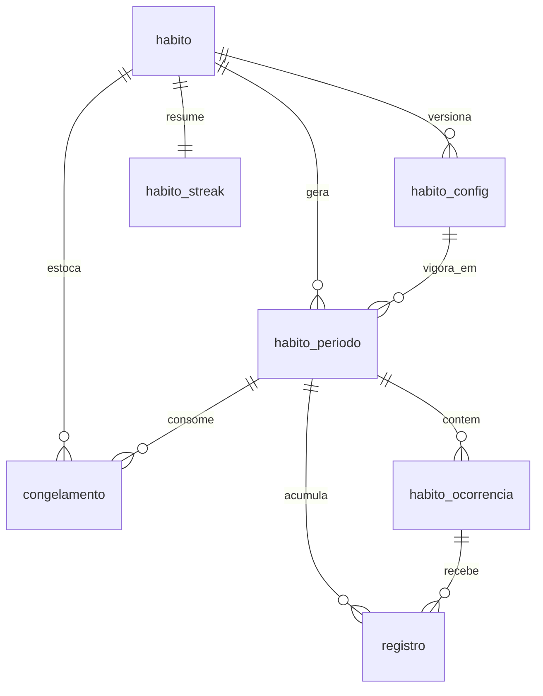

# Mapa do banco

PostgreSQL em contêiner Docker no homelab. Não há tabela de usuários: o app é single-tenant e nenhuma tabela de domínio carrega `user_id`.

Convenções: `id` é `uuid` com `gen_random_uuid()` (extensão `pgcrypto`); todo instante é `timestamptz`; toda data lógica é `date` já ajustada pela virada das 04:00 (ver [Mapa de regras](Mapa%20de%20regras.md)); nomes de tabela no singular.

## Migrations com Knex

Knex.js é a ferramenta de schema. Migrations e seeds versionados no repositório, aplicados na subida do contêiner — nenhum schema aplicado à mão.

```
knexfile.ts            # lê DATABASE_URL, client pg, aplica os parsers de tipo
db/pg-types.ts         # DATE como string, NUMERIC como number
db/knex.ts             # instância singleton usada pelo app
db/tipos.ts            # tipos das linhas, registrados via Knex.TableType
db/cli.ts              # comandos de banco pela API do Knex
db/migrations/         # uma migration por mudança, com up e down
db/seeds/              # semeia config_app e a credencial inicial a partir do .env
```

Scripts em `package.json`:

```
db:up        sobe o Postgres de desenvolvimento
db:down      derruba o Postgres de desenvolvimento
db:make      cria uma migration
db:migrate   aplica as pendentes
db:rollback  reverte o último lote (--all reverte tudo)
db:status    versão atual, aplicadas e pendentes
db:seed      roda os seeds
db:reset     rollback --all + migrate + seed
```

Os comandos passam pela **API** do Knex em `db/cli.ts`, não pelo binário `knex`: o CLI dele com `knexfile.ts` depende de registrar um loader de TypeScript no próprio processo, o que quebra com facilidade no Windows. Chamar a API sob `tsx` funciona igual em qualquer máquina e dentro do contêiner.

Pontos de atenção na combinação Knex + Next.js:

- **Uma única pool por processo.** O hot reload do Next recria módulos e, sem cuidado, abre uma pool nova a cada recarga até esgotar as conexões do Postgres. A instância do Knex precisa ser um singleton guardado em `globalThis` em desenvolvimento.
- **`knexfile.ts` em TypeScript** exige o CLI do Knex rodando sob `tsx`; vale fixar isso nos scripts para não depender de configuração local.
- **Migrations não devem importar código do app** (nem tipos do domínio): elas precisam continuar aplicáveis mesmo depois de o código mudar de forma.
- O worker de notificações e a CLI de reset usam a mesma configuração do Knex, cada um com pool pequena e própria.

Knex é também a **camada de consulta** do app, não só a ferramenta de schema — uma biblioteca de banco só. Os tipos das linhas são declarados à mão e registrados via `Knex.TableType`, de modo que `knex('habito')` já devolva linhas tipadas sem ORM no meio.

## Visão geral



## Domínio

### `habito`

Identidade do hábito. Separado da configuração porque a configuração é versionada.

| Coluna | Tipo | Notas |
|---|---|---|
| `id` | uuid PK | |
| `nome` | text NOT NULL | o emoji de sinalização faz parte do nome (ex.: `💧 Água`) |
| `cor` | text NOT NULL | token de cor (ex.: `violeta`), não hex solto |
| `tipo` | `habito_tipo` NOT NULL | `binario` \| `quantificado` \| `duracao` \| `negativo` |
| `inicio_em` | date NOT NULL | primeira data lógica válida; limita o retroativo |
| `ordem` | int NOT NULL | posição no dashboard; semeada pela ordem de criação, editável por arraste |
| `pausado_de` | date NULL | |
| `pausado_ate` | date NULL | NULL com `pausado_de` preenchido = pausa aberta |
| `arquivado_em` | timestamptz NULL | soft delete; preserva histórico. Não há exclusão |
| `criado_em` | timestamptz NOT NULL | |

A ordenação padrão é `criado_em`, e `ordem` nasce com esse mesmo sequenciamento — reordenar manualmente só reescreve `ordem` numa transação. Com a quantidade de hábitos de uso pessoal, renumerar inteiros é mais simples que posições fracionárias.

### `habito_config`

Uma linha por versão da configuração. **Nunca sofre UPDATE**: editar um hábito fecha a versão vigente (`vigente_ate`) e insere outra. É o que mantém o histórico honesto quando a regra muda.

| Coluna | Tipo | Notas |
|---|---|---|
| `id` | uuid PK | |
| `habito_id` | uuid FK → `habito` | parte da FK composta (ver nota abaixo) |
| `tipo` | `habito_tipo` NOT NULL | cópia de `habito.tipo`, mantida em sincronia pela FK composta |
| `versao` | int NOT NULL | sequencial por hábito |
| `vigente_de` | date NOT NULL | data lógica |
| `vigente_ate` | date NULL | NULL = versão atual |
| `cadencia` | `cadencia_tipo` NOT NULL | `diario` \| `cada_n_dias` \| `semanal` \| `mensal` |
| `cadencia_intervalo` | int NULL | só para `cada_n_dias` |
| `modo` | `modo_tipo` NOT NULL | `flexivel` \| `fixo` |
| `meta_ocorrencias` | int NULL | modo `flexivel` |
| `dias_semana` | int[] NULL | modo `fixo`, 1–7 com **1 = domingo** |
| `dias_mes` | int[] NULL | modo `fixo`, 1–31 |
| `horarios` | time[] NULL | modo `fixo`; também define o lembrete |
| `notificar_em` | time NULL | modo `flexivel`, lembrete único |
| `meta_valor` | numeric NULL | tipo `quantificado` |
| `unidade` | text NULL | tipo `quantificado` (`L`, `páginas`, `km`) |
| `meta_minutos` | int NULL | tipo `duracao` |
| `tolerancia_recaidas` | int NULL | tipo `negativo`, padrão 0 |
| `congelamento_ativo` | boolean NOT NULL | |
| `congelamento_a_cada` | int NULL | interações consecutivas por congelamento ganho |
| `congelamento_max` | int NULL | teto do estoque |
| `criado_em` | timestamptz NOT NULL | |

Restrições que valem como CHECK, porque são a defesa contra a combinação sem sentido que o modelo antigo permitia:

- `modo = 'flexivel'` ⇒ `meta_ocorrencias` NOT NULL e `dias_semana`/`dias_mes`/`horarios` NULL
- `modo = 'fixo'` ⇒ pelo menos um de `dias_semana`/`dias_mes`/`horarios` preenchido e `meta_ocorrencias` NULL
- `cadencia = 'cada_n_dias'` ⇒ `cadencia_intervalo >= 2` **e `modo = 'flexivel'`**
- `cadencia = 'semanal'` ⇒ `dias_mes` NULL; `cadencia = 'mensal'` ⇒ `dias_semana` NULL
- `cadencia IN ('diario','cada_n_dias')` ⇒ `dias_semana`/`dias_mes` NULL
- `congelamento_ativo` ⇒ `congelamento_a_cada >= 1` e `congelamento_max >= 1`
- campos de meta coerentes com `tipo` (`meta_valor`+`unidade` só em `quantificado`, `meta_minutos` só em `duracao`, `tolerancia_recaidas` só em `negativo`)
- índice único parcial: um só `vigente_ate IS NULL` por `habito_id`

> **Por que `tipo` é duplicado aqui.** CHECK no Postgres não pode referenciar outra tabela, então validar os campos de meta contra `habito.tipo` seria impossível com `tipo` só em `habito`. A saída é `habito` ter `UNIQUE (id, tipo)` e `habito_config` referenciá-lo por FK composta `(habito_id, tipo)` com `ON UPDATE CASCADE`. A coluna é redundante, mas a FK garante que nunca divirja — e em troca o banco passa a rejeitar `meta_minutos` num hábito quantificado, em vez de depender só da validação da aplicação.

### `habito_periodo`

Janela de avaliação materializada, criada pelo worker quando o período começa.

| Coluna | Tipo | Notas |
|---|---|---|
| `id` | uuid PK | |
| `habito_id` | uuid FK → `habito` | |
| `config_id` | uuid FK → `habito_config` | regra vigente à época |
| `inicio` | date NOT NULL | data lógica |
| `fim` | date NOT NULL | data lógica, inclusiva. **Mutável em `cada_n_dias`** |
| `meta_ocorrencias` | int NOT NULL | snapshot da meta, não lido da config em runtime |
| `concluidas` | int NOT NULL DEFAULT 0 | denormalizado para o dashboard |
| `status` | `periodo_status` NOT NULL | `aberto` \| `cumprido` \| `congelado` \| `falhou` |
| `fechado_em` | timestamptz NULL | |
| `criado_em` | timestamptz NOT NULL | |

- UNIQUE (`habito_id`, `inicio`)
- UNIQUE parcial em (`habito_id`) WHERE `status = 'aberto'` — no máximo um período aberto por hábito
- índice em (`status`, `fim`) — varredura de fechamento do worker
- índice em (`habito_id`, `fim` DESC) — histórico e recálculo de sequência

Não existe estado de espera nem prazo de resgate: o fechamento decide entre `congelado` e `falhou` na mesma transação, conforme o estoque de congelamento.

Períodos são gerados **sob demanda em todas as cadências**, nunca com antecedência. `cada_n_dias` não permitiria pré-geração (o próximo início depende da conclusão do atual), e uniformizar o resto pelo mesmo caminho dá o invariante acima de graça — além de impedir que um período futuro nasça apontando para uma versão de config que ainda vai ser editada.

### `habito_ocorrencia`

Unidade marcável do modo `fixo`. No modo `flexivel` esta tabela fica vazia e os registros se ligam direto ao período.

| Coluna | Tipo | Notas |
|---|---|---|
| `id` | uuid PK | |
| `periodo_id` | uuid FK → `habito_periodo` | |
| `previsto_para` | timestamptz NOT NULL | data lógica + horário |
| `status` | `ocorrencia_status` NOT NULL | `pendente` \| `cumprida` \| `perdida` |
| `cumprida_em` | timestamptz NULL | |

- UNIQUE (`periodo_id`, `previsto_para`)
- índice em (`status`, `previsto_para`) — disparo de lembrete

### `registro`

Evento bruto: o que você de fato fez (ou, em hábito `negativo`, a recaída). Desmarcar apaga a linha — sem tabela de estorno, porque é uso pessoal e a auditoria em `origem` mais o recálculo bastam.

| Coluna | Tipo | Notas |
|---|---|---|
| `id` | uuid PK | |
| `periodo_id` | uuid FK → `habito_periodo` | sempre preenchido |
| `ocorrencia_id` | uuid FK → `habito_ocorrencia` NULL | só no modo `fixo` |
| `data_logica` | date NOT NULL | a que dia o registro pertence |
| `valor` | numeric NOT NULL DEFAULT 1 | 1 (binário/negativo), quantidade, ou minutos |
| `origem` | `registro_origem` NOT NULL | `app` \| `retroativo` \| `cronometro` |
| `criado_em` | timestamptz NOT NULL | quando foi efetivamente registrado |

`data_logica` ≠ `criado_em::date` é exatamente o caso do retroativo e da madrugada — por isso as duas colunas existem.

### `congelamento`

Estoque unitário: uma linha por congelamento, não um contador. Isso dá rastro de quando foi ganho, gasto e estornado, e permite consumo FIFO.

| Coluna | Tipo | Notas |
|---|---|---|
| `id` | uuid PK | |
| `habito_id` | uuid FK → `habito` | |
| `status` | `congelamento_status` NOT NULL | `disponivel` \| `consumido` |
| `ganho_em` | timestamptz NOT NULL | ordem de consumo (mais antigo primeiro) |
| `ganho_por_periodo_id` | uuid FK → `habito_periodo` | período que fechou a sequência do ganho |
| `consumido_em` | timestamptz NULL | preenchido automaticamente no fechamento |
| `consumido_periodo_id` | uuid FK → `habito_periodo` NULL | |
| `estornado_em` | timestamptz NULL | volta a `disponivel` |

- índice parcial em (`habito_id`, `ganho_em`) WHERE `status = 'disponivel'` — estoque e escolha do FIFO

### `habito_streak`

Resumo materializado, 1:1 com hábito. Sempre recalculável a partir de `habito_periodo`; existe para o dashboard não varrer histórico a cada carga, já que cada linha da tela mostra a sequência do próprio hábito.

| Coluna | Tipo | Notas |
|---|---|---|
| `habito_id` | uuid PK FK → `habito` | |
| `sequencia_atual` | int NOT NULL | interações consecutivas no prazo |
| `sequencia_recorde` | int NOT NULL | |
| `total_no_prazo` | int NOT NULL | total histórico |
| `desde` | date NULL | início da sequência atual |
| `atualizado_em` | timestamptz NOT NULL | |

## Autenticação e infraestrutura

Detalhes de fluxo em [Mapa de autenticação](Mapa%20de%20autentica%C3%A7%C3%A3o.md).

### `credencial_senha`

Linha única. Usada no primeiro acesso e depois desativada. Semeada pelo seed a partir do `.env`.

| Coluna | Tipo | Notas |
|---|---|---|
| `id` | uuid PK | |
| `hash` | text NOT NULL | Argon2id |
| `ativa` | boolean NOT NULL | vira `false` ao cadastrar a biometria |
| `desativada_em` | timestamptz NULL | |
| `atualizada_em` | timestamptz NOT NULL | |
| `unico` | boolean NOT NULL DEFAULT true | `UNIQUE` + `CHECK (unico)` garantem no banco que só existe uma linha |

### `credencial_passkey`

| Coluna | Tipo | Notas |
|---|---|---|
| `id` | uuid PK | |
| `credential_id` | bytea UNIQUE NOT NULL | id da credencial WebAuthn |
| `public_key` | bytea NOT NULL | |
| `counter` | bigint NOT NULL | contador anti-clonagem |
| `transports` | text[] NULL | |
| `aaguid` | uuid NULL | |
| `apelido` | text NULL | "iPhone", para a tela de ajustes |
| `criada_em` | timestamptz NOT NULL | |
| `ultimo_uso_em` | timestamptz NULL | |

### `webauthn_desafio`

Desafios de registro/autenticação com expiração curta (5 min) e consumo único.

| Coluna | Tipo | Notas |
|---|---|---|
| `id` | uuid PK | |
| `desafio` | bytea NOT NULL | |
| `tipo` | text NOT NULL | `registro` \| `autenticacao` |
| `expira_em` | timestamptz NOT NULL | |
| `consumido_em` | timestamptz NULL | |

### `sessao`

| Coluna | Tipo | Notas |
|---|---|---|
| `id` | uuid PK | |
| `token_hash` | text UNIQUE NOT NULL | o token vai no cookie httpOnly; o banco guarda só o hash |
| `criada_em` | timestamptz NOT NULL | |
| `expira_em` | timestamptz NOT NULL | |
| `user_agent` | text NULL | |
| `revogada_em` | timestamptz NULL | reset de biometria revoga todas |

### `tentativa_login`

Base do rate limiting, que entra já na onda 1. Em tabela, e não em memória, para sobreviver ao restart do contêiner.

| Coluna | Tipo | Notas |
|---|---|---|
| `id` | uuid PK | |
| `ip` | inet NOT NULL | de `CF-Connecting-IP`, nunca do socket |
| `sucesso` | boolean NOT NULL | |
| `criada_em` | timestamptz NOT NULL | |

- índice em (`ip`, `criada_em` DESC)
- limpeza periódica pelo worker: descartar o que passou de 7 dias

> Atrás do Cloudflare Tunnel, o IP do socket é sempre o do túnel. Ler o IP real de `CF-Connecting-IP` é obrigatório, ou o bloqueio por IP viraria um bloqueio global.

### `push_subscription`

| Coluna | Tipo | Notas |
|---|---|---|
| `id` | uuid PK | |
| `endpoint` | text UNIQUE NOT NULL | |
| `p256dh` | text NOT NULL | |
| `auth` | text NOT NULL | |
| `criada_em` | timestamptz NOT NULL | |
| `invalida_em` | timestamptz NULL | marcada quando o push service responde 404/410 |

### `notificacao_enviada`

Guarda de idempotência: o worker roda a cada minuto e não pode notificar duas vezes o mesmo evento.

| Coluna | Tipo | Notas |
|---|---|---|
| `id` | uuid PK | |
| `tipo` | text NOT NULL | `lembrete` \| `meta_atraso` \| `congelamento_usado` \| `sequencia_perdida` |
| `referencia_id` | uuid NOT NULL | ocorrência ou período |
| `enviada_em` | timestamptz NOT NULL | |

- UNIQUE (`tipo`, `referencia_id`)

### `config_app`

Chave/valor para o que é global, semeado a partir do `.env`: `usuario_nome` (saudação do dashboard), `hora_virada` (`04:00`), `timezone` (`America/Sao_Paulo`), `semana_inicia_em` (`domingo`), `vapid_public_key`, `vapid_private_key`, `rp_id`.

> `rp_id` armazenado serve de trava de segurança: se o domínio mudar, o app detecta a divergência e explica que as passkeys foram invalidadas, em vez de falhar silenciosamente.

## Operação

- **Backup**: `pg_dump` agendado no host, com retenção. Ponto cego clássico de homelab, e aqui o banco é a única cópia do histórico.
- **Acesso**: o Postgres não é exposto fora da rede do Docker; só o app, o worker e a CLI de reset conectam.
- **Recálculo**: existe um comando de recálculo integral de sequências e congelamentos a partir de `habito_periodo`, usado após edição retroativa e disponível como ferramenta de reparo manual.
